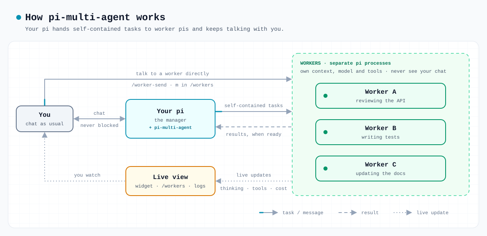

# pi-multi-agent

Let your [pi](https://github.com/earendil-works/pi) hand work to other pi agents that run in parallel, and watch
them think while they work.

<picture>
  <source media="(prefers-color-scheme: dark)" srcset="docs/assets/how-it-works-dark.svg">
  
</picture>

## Install

```bash
pi install git:github.com/laminko/pi-multi-agent
```

Or try it once without installing: `pi -e git:github.com/laminko/pi-multi-agent`. You need pi (tested with 1.6.0)
and a working model.

## Use

Ask pi in plain language:

> Spawn two read-only workers in parallel (tools: read, grep, find, ls). One summarizes what this project does in
> five bullets; the other lists every TODO and FIXME comment with file and line.

pi starts the workers and keeps talking with you. Each result appears as a `⚑ worker … done` message when it is
ready.

## Watch

The widget above the editor shows every worker, with its latest thinking (💭):

```
 St  Worker    Turns  Tools  Ctx  ↑In  ↓Out   Cost  Time  Now
 ●   reviewer      3      2  1.5%   4  1.4k  $0.14   25s  💭 …I'm also flagging that the `__main__` module lacks a guard…
 ✓   tests         4      3  1.2%  10  6.1k  $0.17   48s  → I wrote `tests/test_todo.py`. It has 39 tests…
```

Type `/workers` for a live view of one worker: its thinking, output and tool calls.

You don't need to watch for stuck workers. The manager checks running workers every 10 s; when one goes silent,
stops answering or loops, you see `⚠` in the widget and the manager follows up on it by itself.
`PI_MULTI_AGENT_HEALTH_INTERVAL` changes the interval.

Idle workers clean up after themselves: a finished worker that is not reused for 10 minutes
(`PI_MULTI_AGENT_IDLE_MINUTES`) has its process stopped. `worker_send` starts it again with its context.

## If pi quits

Reopen with `pi -c` and type `/workers-resume`. Interrupted workers continue where they stopped.

## Learn more

- [User guide](docs/user-guide.md): prompting, stepping in, cost, limits
- [Observability](docs/observability.md): everything about watching workers
- [Reference](docs/reference.md): every tool, command and setting
- [Runbook](RUNBOOK.md): install details, troubleshooting, tests
- [Status](STATUS.md): what is verified, known issues

## License

[MIT](LICENSE)
