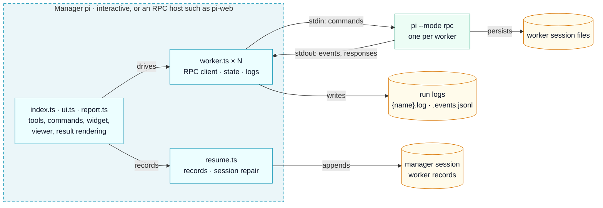
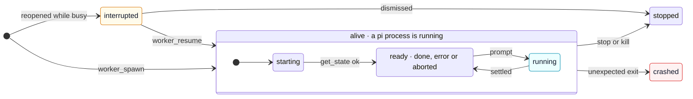

# Architecture

How v0.7.0 works inside, and why it is built this way. For behavior and defaults, see the [Reference](reference.md).

## Overview

| File | Responsibility |
|---|---|
| `index.ts` | Extension entry: registry, tools, commands, message renderer, dialog forwarding, auto-notify, wait loop, widget plumbing, session lifecycle |
| `worker.ts` | One worker process: spawn, strict JSONL RPC client, event → state mapping, transcript, log files, shutdown escalation |
| `ui.ts` | Widget component / plain lines, and the `/workers` viewer component |
| `format.ts` | Shared text formatting (status table, legend, reports, numbers) |
| `resume.ts` | Resume after quit: worker record format and merge, interrupted detection, session repair, old-process check |
| `report.ts` | Worker result blocks: the LLM text (`formatResultBlock`, `formatRunningBlock`), its parser, and the TUI renderer for tool rows and auto-report messages |

## Process model

A worker is started as a child process running pi's own CLI:

- **Launch:** `process.execPath` with `process.argv[1]` (pi's CLI script) when that file exists. Bun-compiled pi binaries
  launch themselves, and the fallback is `pi` on `PATH`. This is the same strategy as pi's bundled subagent example.
  It runs the same pi version as the manager, without depending on `PATH`.
- **Arguments:** `--mode rpc --name worker:<name>`, then optionally `--model`, `--thinking`, `--tools`,
  `--append-system-prompt <run>/<name>.role.md`, then `PI_MULTI_AGENT_WORKER_ARGS`.
- **Environment:** inherits the manager's, plus `PI_MULTI_AGENT_ROLE=worker` and `PI_MULTI_AGENT_WORKER=<name>`.
  The extension returns early when `PI_MULTI_AGENT_ROLE=worker`, so workers never get the worker tools. This prevents
  recursive spawning.
- **cwd:** the manager's cwd, or the `cwd` parameter.

Workers load the user's settings, packages, skills and context files like any pi. That is intentional: a worker is a
full pi.

## RPC protocol usage

`Worker` implements its own minimal client instead of pi's exported `RpcClient`, for two reasons:

1. `RpcClient` copies child stderr to `process.stderr`. Inside an interactive manager, that would corrupt the TUI.
2. `RpcClient` spawns `node` from `PATH`. We want the manager's own runtime and CLI path (see above).

Framing is strict JSONL: a `StringDecoder` handles multi-byte boundaries, records are split on `\n` only, and an
optional trailing `\r` is stripped. Unlike Node's `readline`, U+2028/U+2029 inside JSON strings are not treated as line
breaks. Stdout is always consumed, so the child never blocks on a full pipe.

Commands are correlated by `id` (`ma-1`, `ma-2`, …) with per-command timeouts:

| Command | Used for | Timeout |
|---|---|---|
| `get_state` | startup handshake; session file/id, resolved model, thinking level | 120 s |
| `prompt` | new task (idle worker) | 60 s for acceptance |
| `steer` / `follow_up` | messages while busy | 60 s |
| `abort` | abort the current task (responds once idle) | 30 s (5 s during shutdown) |

A `prompt` response only means "accepted". Completion is signaled by the `agent_settled` event. If the response's
`disposition` is `handled` (an extension command consumed it), no run starts and the worker returns to idle.

### Event → state mapping

| Event | Effect on `Worker` |
|---|---|
| `agent_start` | `busy = true`, status `running` |
| `turn_start` | `turns++`, activity `waiting for model`, log `── turn N ──` |
| `message_start` (assistant) | reset per-message stream tracking |
| `message_update` `thinking_start/delta/end` | stream into a `thinking` transcript entry, `thinkingTail`, log `┊`; the `_end` content is authoritative |
| `message_update` `text_start/delta/end` | stream into a `text` entry, log `│` |
| `message_update` `toolcall_start` | activity `calling <tool>` |
| `message_end` (assistant) | add usage and cost, record the stop reason and errors; backfill thinking/text blocks the provider did not stream; update `lastText` |
| `tool_execution_start` | `toolCalls++`, activity `<tool> <args summary>`, `tool` entry |
| `tool_execution_end` | `toolErrors++` on error, `toolResult` entry (first lines), duration |
| `queue_update` | `queued` = pending steer + follow-up count |
| `auto_retry_start/end`, `compaction_start/end` | activity + `info`/`error` entries |
| `agent_settled` | `busy = false`; status `idle` / `error` / `aborted`; `result = lastText`; write `<name>.result.md`; emit `settled` |
| process `close` | if not stopping: status `crashed` with the exit reason and stderr tail; reject pending commands; emit `settled` if it was busy |

`extension_ui_request` records are handled separately. `select`/`confirm`/`input`/`editor` are forwarded to the
manager's UI via `WorkerHost.dialog` and answered with `extension_ui_response`; the call waits on the user, and there is
no timeout unless the worker set one. `notify` goes to the transcript, and only warnings and errors also reach the
manager UI. `setStatus`, `setWidget`, `setTitle` and `set_editor_text` are ignored.

## Worker state machine

`ready` is the status label `done`, `error` or `aborted`, depending on how the last task ended; in all three the
worker is alive and the next prompt starts a new task. While `running`, steer and follow-up messages are queued into
the current task. `stopped` is an intentional exit (including a failed start or a dismissed interrupted worker);
`crashed` keeps the exit reason and the stderr tail. A resumed worker is a new process on the old session file, so it
re-enters `alive` at `starting`.

`busy` is the authoritative "working" flag. It is set **synchronously before** `prompt` is sent, so a
`worker_wait` issued right after `worker_spawn` can never see a false "done". It is cleared by `agent_settled`, a
`handled` disposition, a rejected prompt, or process exit.

## Results and notification

- **Result** = text of the last assistant message with text content during the task (`lastText` at `agent_settled`).
  Thinking and tool output are not part of the result.
- **`reported`** tracks whether the current task's result has reached the manager LLM:
  - reset to `false` by `prompt` and by `send` (new information is coming);
  - set to `true` by `worker_wait` results, by the `worker_stop` tool, by any kill, by shutdown, and by an
    auto-notification. Aborts you trigger yourself (viewer `a`, `/worker-stop <name>` without `kill`) leave it `false`,
    so the manager is told that its worker was aborted.
- **User toast** (`onSettled`), when a worker settles and is not `stopping`: `ctx.ui.notify("Worker <name> <status>")`,
  `info` for done and `warning` otherwise. This shows at once, even while the manager is in a turn.
- **Auto-notify** (`onSettled`), when a worker settles: skip if it is `stopping`, already `reported`, or has `notify`
  set to `false`, **or if any `worker_wait` call is currently waiting on it** (tracked with a per-name waiter count).
  Otherwise it calls `pi.sendMessage({customType: "multi-agent", …}, {deliverAs: "followUp", triggerTurn: true})`.
  An idle manager starts a turn right away. A busy manager gets the message after its current run.
- **Waiting** is a 400 ms poll of `busy` across the target workers, with an abort-aware sleep and a progress update
  at most once per second. Each poll also checks `ctx.hasPendingMessages()`. If the user queued a steer or
  follow-up message, the wait returns `interrupted`. Pi delivers a steer message only after the current tool call
  ends, so without this check a user message waited up to the full timeout (1800 s).
- **Manager prompting.** The `worker_spawn` guidelines tell the manager to end its turn after a spawn, and to call
  `worker_wait` only when the user asks. The manager then stays free to talk, and results come by auto-notify. Polling the authoritative flag is simpler and more robust than coordinating
  one-shot events: a `settled` that fires before the waiter subscribes cannot be missed.

## UI

- **Widget.** In TUI mode, a component factory is registered once. Its `render()` reads live registry state, and
  updates are just `tui.requestRender()` (throttled to 100 ms). In other modes with a UI (RPC hosts), only string
  arrays are supported, so the plain lines are re-sent at most once per second. A 1 s ticker emits `change` while any
  worker is busy, so elapsed times keep moving. The widget is cleared while the viewer is open, and whenever there
  are no workers. Rows are sorted by `widgetOrder()` (running in spawn order, then error/crashed, done/aborted and
  stopped, each newest first) and capped at `PI_MULTI_AGENT_WIDGET_ROWS`; the rest fold into a `… N more` line.
  The component keeps the layout of its last render, so a click maps to the row the user saw even if the order
  changed since.
- **Viewer.** A `ctx.ui.custom()` component. It renders only the tail it needs: it walks transcript entries from
  the end until the viewport plus scroll offset is filled. Each entry's wrapped lines are cached in a `WeakMap` keyed
  by the entry and invalidated by text length or width, so streaming re-wraps only the entry that grows. Registry
  changes trigger renders, throttled to 80 ms. Actions that need dialogs (message, kill-confirm) close the viewer
  with an action value. The command handler then runs the dialog and reopens the viewer on the same worker.
  The tab bar is a window `[tabStart, tabEnd]` over the workers in spawn order: `tabStart` persists across renders
  and moves only when the current tab would fall outside the window, and the window grows left when there is free
  room. The `worker i/N` counter's width is reserved, so it is never cut off.
- **Tool rows and auto-reports.** Custom `renderCall` shows the worker name and task. `renderResult` and the
  auto-report message renderer (`⚑ worker <name> <status>`) both call `renderReport()` (`report.ts`). It parses the
  LLM text back into `<worker>` blocks, markdown tables and plain text, and builds a `Container`: tables and results
  as pi-tui `Markdown`, other text as `Text` (line breaks kept), each part clamped when collapsed. The LLM text is
  never changed for display, and the producer and the parser live in the same file, so they change together. A
  result ends at the `</result>` that is followed by the log note and `</worker>`, so results that contain the tags
  themselves still parse. Anything that does not parse is shown as plain text.

## Files and logging

- `<name>.log` is the human-readable stream, written as events arrive (deltas included), so `tail -f` is live.
- `<name>.events.jsonl` is compact by design. Streaming deltas are dropped, and payloads that repeat other records are
  reduced: `agent_end` messages, `turn_end` message, `message_start`, and the system prompt. The session file is the
  complete record. Before this was in place, a 2-turn task produced ~40 KB; after, a 3-task worker produced ~14 KB.
- `<name>.result.md` is rewritten on every settle.

## Shutdown

`session_shutdown` (quit, `/new`, `/resume`, `/fork`, `/reload`) stops all workers in parallel, then clears the
registry and widget. `Worker.stop()` escalates step by step:

1. `abort` if busy (≤ 5 s)
2. close stdin; pi's orderly shutdown (≤ 3 s)
3. `SIGTERM` (≤ 2 s)
4. second `SIGTERM`: pi exits immediately (≤ 2 s)
5. `SIGKILL`

If the manager process dies without running this, the workers' stdin closes and pi shuts them down on its own.

## Resume after quit

A worker's processes cannot outlive the manager (its stdin and stdout are pipes to the manager). What survives is the
worker's **session file** and the manager's **records** of it, so v0.7.0 resumes the work instead of the process.

- **Records.** `Worker` emits `record` when a task starts (before the prompt is sent, so a quit at any later moment
  finds it busy), when a prompt is rejected or handled, when a task settles, and when the process exits. `index.ts`
  turns each into a `pi.appendEntry("multi-agent-worker", …)` in the manager session, except during
  `session_shutdown` (`shuttingDown`). Records of the current branch merge per worker (later fields win; a resume
  prompt is not recorded as a task, so the original task survives). See the
  [Reference](reference.md#worker-records-manager-session) for the format.
- **Restore.** `session_start` (any reason) rebuilds the busy workers as `Worker` objects with status `interrupted`
  and no process, shows a toast, and arms a note for the model. The note is built in `before_agent_start`, only if
  workers are still interrupted then: a note queued at `session_start` went stale when the user resumed the workers
  before the next run, and the model then claimed they were not running.
- **Repair.** If pi quit while the model was emitting a tool call, the worker session ends with an aborted assistant
  message whose tool calls have no results, and the provider rejects it (`tool_use ids were found without
  tool_result blocks`). `repairSession()` opens the file with pi's `SessionManager` and appends one error `toolResult`
  per unanswered call. It does nothing if anything else came after the tool calls. If pi quit during tool
  *execution*, pi has already recorded an aborted result and nothing needs repair.
- **Resume.** `spawnWorker(…, resumeSession)` starts `pi --mode rpc --session <file>` with the recorded options and
  sends `RESUME_PROMPT`. The new `Worker` replaces the interrupted one in the registry. Without a session file it
  starts fresh with the recorded task plus `INTERRUPTED_NOTE`.
- **Waits during a resume.** The model often sends `worker_resume` (or `worker_spawn`) and `worker_wait` in one
  message, and pi runs them in parallel. The wait therefore counts a worker as working while it is `busy`, `starting`,
  or being resumed (`resuming` set), and looks the worker up by name on every poll (`latest()`), because a resume
  replaces the object.
- **Session location.** New workers get `--session-dir <multi-agent dir>/sessions`, so `pi -c` in the project does
  not open a worker session (before v0.7.0 it did: the worker session was usually the newest).

## Design decisions

| Decision | Why | Alternative considered |
|---|---|---|
| Long-lived `--mode rpc` workers | steer, follow-ups, persistent context, live status, abort without killing | one-shot `--mode json -p` (pi's subagent example): simpler, but fire-and-forget, with no thinking stream in its UI and no transcript (`--no-session`) |
| Own RPC client | stderr must not reach the TUI; use the manager's runtime and CLI | exported `RpcClient` |
| Persist worker sessions by default | full transcript with thinking, viewable in pi and pi-web | `--no-session` (still available through `PI_MULTI_AGENT_WORKER_ARGS`) |
| Auto-notify with `followUp` + `triggerTurn` | the manager can fire and forget; results are never lost | only `worker_wait` (forces the manager to block) |
| Polling wait | robust, no missed-event races, trivial to cancel | event-driven promises |
| Do not wait by default; interrupt a wait on user input | the user can always talk to the manager and steer workers through it | wait by default (v0.1.0): blocked the user for up to 30 min |
| Resume the work, not the process: records + `--session` + repair | survives any quit, including a crash of the manager; uses only pi's session files and APIs | detached workers behind a socket (roadmap): keeps processes alive, but needs a daemon and process ownership rules |
| Worker sessions in their own directory | `pi -c` must find the manager after a quit | keep them in the project's list (pi-web shows them, but `pi -c` opened a worker) |
| Recursion guard through an env var | workers load the same packages | process-tree depth tracking |
| Logs outside the repo (`~/.pi/agent/multi-agent`) | no pollution of projects or git status | `<cwd>/.pi/…` |
| Tools allowlist + role prompt, no sandbox | matches pi's own model; simple | containers / worktrees (roadmap) |

## Security notes

- Workers run with the same OS permissions as the manager. The `tools` allowlist restricts which tools the model
  can call; it is not a sandbox (`bash` can do anything).
- Workers load the user's global packages and the project's trusted resources, like any pi in that directory.
- Task and role text is written to the logs and session files in plain text.
- Dialogs raised inside workers (e.g. permission gates) are forwarded to you rather than auto-approved. Without a
  UI they are cancelled (fail closed).

## pi APIs this depends on

If a pi upgrade changes any of these, re-run the smoke tests in the [Runbook](../RUNBOOK.md#smoke-tests):

- CLI: `--mode rpc`, `--name`, `--model`, `--thinking`, `--tools`, `--append-system-prompt`, `--session`,
  `--session-dir`
- RPC: `get_state`, `prompt`, `steer`, `follow_up`, `abort`, `extension_ui_request/response`, the JSON event stream
  (`agent_settled`, `message_update` sub-events, `tool_execution_*`, `queue_update`, `auto_retry_*`, `compaction_*`)
- Extension API: `registerTool` (`renderCall`/`renderResult`, `promptSnippet`/`promptGuidelines`), `registerCommand`,
  `registerMessageRenderer`, `sendMessage` (`deliverAs`, `triggerTurn`), `ctx.ui.setWidget` (factory and string
  forms), `ctx.ui.custom`, dialogs, `session_start`/`session_shutdown`, `before_agent_start` (`message`),
  `pi.appendEntry`, `ctx.sessionManager.getBranch`, `getAgentDir`, `truncateHead`, `SessionManager.open` +
  `appendMessage` + `getBranch` (session repair)
- pi-tui: `truncateToWidth`, `visibleWidth`, `wrapTextWithAnsi`, `matchesKey`, `Text`, `Markdown` (including
  tables), `Container`, `Spacer`; pi-coding-agent: `getMarkdownTheme`
